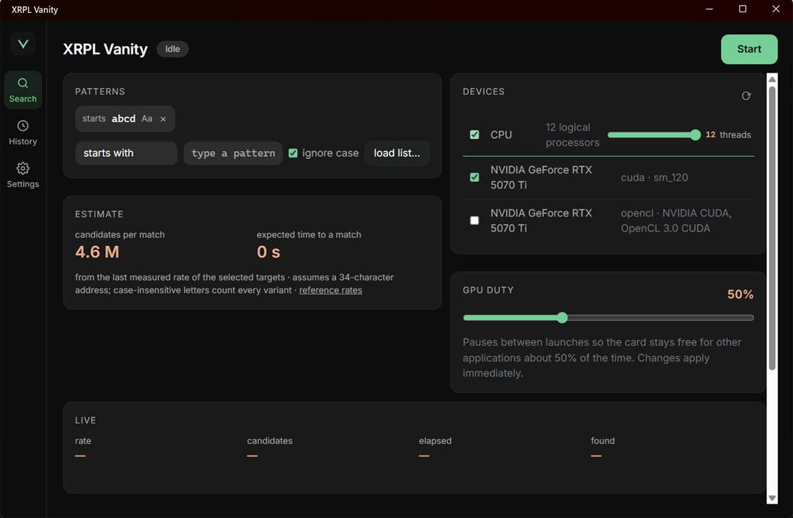

# xrpl-vanity

A multithreaded command-line tool that searches for XRP Ledger (XRPL) accounts
whose address contains a chosen substring — a "vanity address" generator.

It repeatedly generates 16 bytes of cryptographically secure entropy, derives
the corresponding seed and address, and checks the address against your
patterns. When a pattern matches, it prints the address and the seed that
produced it.

**Ed25519 only.** XRPL also supports secp256k1 accounts, but this tool always
derives Ed25519 keys (seeds encoded with the `sEd...` prefix). If you need a
secp256k1 vanity address, this is not the tool for that.

## Building and running

Requires the .NET 10 SDK.

```bash
dotnet run --project src/XrplVanity.Cli -c Release -- --contains xrp --count 1
```

The first run builds the program. In the examples below, `xrpl-vanity` stands for `dotnet run --project src/XrplVanity.Cli -c Release --`. To build everything except the Windows
desktop application, which needs the `maui-windows` workload, use
`dotnet build XrplVanity.Portable.slnf -c Release`.

## Match modes

Patterns can be anchored to the start of the address (right after the leading
`r`), the end, or anywhere inside it. Bare positional words default to
`starts`.

```bash
# targeted words — default position is "starts"
xrpl-vanity ripple hodl xrp

# roulette — patterns loaded from a word list, minimum length 5
xrpl-vanity --list words.txt 5

# suffix / anywhere — mix positions in a single run
xrpl-vanity --ends xyz --contains dao

# paired — the body must start with abc AND end with xyz
xrpl-vanity --starts-ends abc:xyz
```

A run may combine `--starts`, `--ends`, `--contains`, and `--starts-ends`
together, and a candidate address matches if *any* pattern matches at its
tagged position. `--starts-ends PREFIX:SUFFIX` is the one exception to "any
pattern is one condition": it requires both halves on the same address, so a
prefix of *m* characters plus a suffix of *n* characters costs exactly as
much as a single prefix of *m + n* characters — the cost is set by the
number of constrained characters, not by how they are split between the two
ends. The halves may touch but never overlap: an address whose body is
shorter than *m + n* cannot satisfy the rule. No body is longer than 33
characters, so halves totalling more than that are rejected as unreachable
rather than searched for.

## Flags

| Flag | Default | Meaning |
| --- | --- | --- |
| positional words | — | patterns for the `starts` bucket |
| `--starts P` | — | a pattern to match at address start, after `r` (repeatable) |
| `--near-start P` | — | a pattern that may begin at the 2nd or 3rd address character (`rWORD…` or `r?WORD…`); see below (repeatable) |
| `--ends P` | — | a pattern to match at address end (repeatable) |
| `--contains P` | — | a pattern to match anywhere (repeatable) |
| `--starts-ends PREFIX:SUFFIX` | — | requires both a prefix and a suffix on the same address (repeatable) |
| `--near-starts-ends PREFIX:SUFFIX` | — | as `--starts-ends`, but the prefix may begin at the 2nd or 3rd address character (repeatable) |
| `--list FILE [minLen]` | — | load `starts` patterns from a word list, optional min length filter (default 4) |
| `--case-sensitive` | off (case-insensitive) | match the pattern exactly as typed; by default every case combination is matched |
| `--threads N` | `ProcessorCount` | number of worker threads (CPU path only; ignored with `--gpu`) |
| `--out FILE` | — | append matches to a file as well as stdout |
| `--count N` | — | stop after N matches (otherwise run until interrupted, e.g. Ctrl+C) |
| `--gpu` | off | search on the GPU (CUDA preferred, then OpenCL; every GPU hit is re-verified by the CPU before it is printed) |
| `--backend NAME` | — | force the GPU backend: `cuda` or `opencl` (case-insensitive; implies `--gpu`; combine with `--device` to pick a specific one) |
| `--device N` | — | pick a device by index: within the chosen `--backend`, or (without `--backend`) into the flat list `--list-devices` prints (implies `--gpu`) |
| `--list-devices` | — | list every device from every backend, one per line, and exit (`0` if any device was found, `2` otherwise) |
| `--gpu-devices SPEC` | — | run on several devices at once: `all`, `cuda`, `opencl`, or a comma-separated list of `backend:index` / `--list-devices` indices (implies `--gpu`; not combinable with `--backend`/`--device`) |
| `--gpu-duty N` | `100` | keep the GPU busy about N% of the time (1–100): after each launch the search pauses for `launch time × (100 − N) / N`, leaving the card to other applications in between; throughput scales with N |

XRPL addresses use the base58 alphabet
`rpshnaf39wBUDNEGHJKLM4PQRST7VWXYZ2bcdeCg65jkm8oFqi1tuvAxyz` — 58 characters; `0`, `O`, `I` and `l`
do not exist, so `o` and `i` occur only in lower case and `L` only in upper case.
The character right after the leading `r` is not uniform: it is one of
`pshnaf39wBUDNEGHJKLM4P` about 94% of the time, `Q` about 1.5%, and anything else only
about 0.07% each — so a prefix that starts with, say, `c` or `z` is roughly 58 times
rarer than one that starts with `a`.
Patterns are normalized into this alphabet (`l -> L`, `0 -> o`,
`O -> o`, `I -> i`). A pattern that still contains a character that cannot
occur in an address (outside the base58 alphabet, even after normalization)
is reported as unreachable and skipped instead of searching forever.

### Case-insensitive matching

By default (no `--case-sensitive`), a pattern matches **every** reachable
case combination: `--starts ab` matches an address body starting with `ab`,
`aB`, `Ab`, or `AB`. Letters that exist in only one case in the base58
alphabet do not multiply the count — `i` and `o` are lower-case only and
`l` only exists as `L`, so `oil` has the single reachable form `oiL`.

To keep the number of combinations bounded, case expansion applies only to
patterns of at most 12 characters (up to 2^12 combinations). A longer
pattern is still searched, but case-sensitively — the tool prints a warning
saying so. Pass `--case-sensitive` to match any pattern exactly as typed.

### Starting one character later

The character right after the leading `r` of a 34-character address can only
be one of `pshnaf39wBUDNEGHJKLM4PQ`: the address encodes a 192-bit number,
and 2^192 is only about 23.3 times 58^32. Any other first character (`X`,
`S`, `A`, `x`, ...) appears there only in the rare 33-character addresses, so
`--starts XRPLFILE --case-sensitive` takes about 23 times longer than an
8-character prefix normally would. The third character has no such bias.
`--near-start XRPLFILE` also accepts the pattern one character later
(`r?XRPLFiLE...`), which finds it about 24 times sooner; for a first
character that can follow the `r` it gains only about 1.4 times.
`--near-starts-ends XRPL:FILE` does the same for the prefix half of a pair
(`r?XRPL...FiLE`) and gains the same factor; the suffix stays at the end.
The desktop app offers the same choice as the "2nd or 3rd char" box in both
`starts with` and `starts and ends with` modes, and suggests it on any chip
that would gain at least 2 times.

## Exit codes

`0` — a `--count` target was fully satisfied. `2` — invalid usage (unknown
or malformed option, or no reachable pattern). `130` — the run was ended by
Ctrl+C, or a `--count`-less search was interrupted, before a `--count`
target was met.

## Secret handling

**A seed is a secret.** Anyone who holds it controls the account. Before
starting a search, the tool prints a one-time warning to this effect. Matches
are written to stdout (and to `--out FILE` if given) and nowhere else — the
tool has no network access and no telemetry. Treat every seed it prints as
sensitive: keep matches offline, and verify this tool yourself before using a
generated key to hold real funds.

## Performance

The search runs on `Environment.ProcessorCount` threads by default (override
with `--threads`), each with its own key deriver and CSPRNG-filled entropy
buffer, so the hot loop has no shared mutable state beyond a lock-free match
counter. At the end of a CPU run the CLI prints `CPU: searched N candidates in
T s (R/s).` on stderr, mirroring the GPU line.

Measured throughput on the reference machine — CPU, CUDA, OpenCL, pocl and
multi-device — is recorded with the commands that produced it in
[`docs/benchmarks.md`](docs/benchmarks.md).

### Sharing the GPU

A GPU search keeps the card fully busy. To leave room for other applications while
a long search runs, pass `--gpu-duty N`: after every launch (about 50 ms on the
reference card) the search sleeps for `launch time × (100 − N) / N`, so the device is
busy about N% of wall time on average and idle otherwise. A launch is never
interrupted, so the granularity is one launch; throughput drops roughly in
proportion.
The flag applies to `--gpu`, `--backend`/`--device` and every device of
`--gpu-devices`. Measured utilisation is in [`docs/benchmarks.md`](docs/benchmarks.md).

```bash
xrpl-vanity --gpu --gpu-duty 80 --contains fastconn --count 1 --out fastconn.tsv
```

The address-derivation core (`XrplVanity.Core`) is deliberately kept free of
CLI and threading concerns so its semantics — `entropy -> address` — can be
reproduced bit-for-bit by a GPU backend for much higher throughput. `--gpu`
runs the search on the device. The host builds the same pattern set the CPU
path uses and uploads it; the kernel derives and matches candidates on the
GPU; every reported hit is re-derived by the CPU reference and printed only
if it agrees — this gate applies to every backend, so a device the CPU
reference disagrees with only costs throughput (reported as a consistency
error), never a wrong key. At the end of a device run the CLI prints
`GPU: searched N candidates in T s (rate/s); consistency errors: E` on stderr,
where `T` is the device's own search time — opening the device and compiling its
program are outside it. Without a usable GPU device `--gpu` exits with code 2
rather than silently using the CPU.

## GPU backends (CUDA and OpenCL)

Two backends implement the same kernel source: CUDA (NVIDIA only, the
longest-verified path) and OpenCL. `--gpu` without `--backend` opens the
first usable device in preference order — CUDA, then OpenCL. CUDA is tried
first because its program ships precompiled (PTX, no run-time compilation
and no dependence on the vendor's OpenCL compiler — a cold OpenCL compile
takes 30–40 s on the reference card). On the reference RTX 5070 Ti, the two
backends measured within 1% of each other (see `docs/benchmarks.md`). Pass
`--backend opencl` to select OpenCL, optionally with
`--device N` to pick a specific device within it; run `--list-devices` first
to see what is available and at which flat index (`--device N` without
`--backend` indexes that flat list). The OpenCL backend compiles the kernel
source at run time, in the device's constructor — the first run can take
tens of seconds while the vendor driver JIT-compiles; the CLI prints a
`note: compiling the OpenCL program took N s` line whenever that exceeds a
second, and the driver's on-disk cache makes subsequent runs fast. The
OpenCL backend has been validated on NVIDIA's OpenCL implementation
(Windows) and on pocl 5.0 (Linux, CPU). AMD and Intel implementations are
expected to work (OpenCL C 1.2 is a portable standard) but remain untested.

### Multiple devices

`--gpu-devices all` runs one search engine per device across every backend
at once — on a machine with a single NVIDIA card, that means CUDA and OpenCL
both drive the same card, since each backend enumerates it independently;
pass `--backend`-style filtering via `--gpu-devices cuda` for "every NVIDIA
card, once each" instead. Each device runs its own `GpuSearchEngine` on its
own thread with its own fresh CSPRNG-filled entropy, entirely independent of
the others. `--count` is shared and exact across all devices: matches from
every device funnel into the same sink, and the run stops the instant the
target is reached, even mid-launch on the other devices. Because devices
report from separate threads, the order matches are printed in across
devices is not guaranteed (each device's own hits stay in order relative to
each other). Several OpenCL devices opened together compile their programs
one after another at start-up, not in parallel, so `--gpu-devices all` or
`--gpu-devices opencl:0,opencl:1` on OpenCL-heavy specs can take a while
before the first launch starts. At the end of the run each device gets its own
`GPU[backend:index]: searched N candidates in T s (rate/s); consistency
errors: E` line, where `T` is that device's own search time (opening it and
compiling its program are outside it), followed by one aggregate
`GPU: searched N candidates on D device(s) in T s (rate/s); consistency
errors: E` line whose `T` is the wall time of the whole run.

### Kernel single-source discipline

There is no `.cu` file and no `#ifdef`. The device code is one body,
`gpu/kernels/xrpl_vanity_body.h`, plus two shims that each define the same
set of macros for their platform: `gpu/kernels/cuda_shim.h` (`KERNEL` →
`extern "C" __global__`, `GLOBAL`/`CONSTANT` pointers are plain pointers,
64-bit literals are a native `ull`/`ll` suffix) and `gpu/kernels/opencl_shim.h`
(`KERNEL` → `__kernel`, `GLOBAL` → `__global`, `CONSTANT` → `__constant`,
64-bit literals go through `U64_C(...)`). `gpu/build-ptx.py` concatenates the
CUDA shim with the body and compiles the result to PTX (see below);
`GpuKernels.ReadOpenClSource()` concatenates the OpenCL shim with the same
body and hands it to the vendor's OpenCL compiler at run time.

Because OpenCL C 1.2 has no generic address space, the body follows a
stricter discipline than plain CUDA would need: device functions take
private pointers only, except for the three read-only tables that are
threaded through the call tree as `GLOBAL const` (the base-point table, and
the matcher's `groups` and `chars`); kernels copy their per-thread inputs out
of `GLOBAL` memory into private arrays before calling into device functions,
and copy results back. The full construct-by-construct mapping (kernel
entry, device function, thread index, atomics, 64-bit literals, …) is in the
"Kernel single-source discipline" table in
[`docs/2026-09-03-xrpl-vanity-gpu-opencl-design.md`](docs/2026-09-03-xrpl-vanity-gpu-opencl-design.md).

The body implements the same `entropy -> address` derivation as
`XrplVanity.Core`, verified kernel by kernel against the .NET/BouncyCastle
reference and against RFC 8032 test vectors — CUDA and OpenCL run identical
logic, so both are checked against RFC 8032 and each other in the test
suite. The kernel uses a windowed fixed-base scalar multiplication over a
256-entry table that is built on the device at start-up by the naive
(independently verified) multiplication. On the reference RTX 5070 Ti, the
CLI achieves ~10.7M candidates/s on CUDA and ~12.1M candidates/s on OpenCL.

At development time, the CUDA half is compiled to PTX (target `compute_75`,
i.e. NVIDIA Turing / 2018 or newer — the driver JIT-compiles the PTX for the
actual GPU at load time) with:

```bash
python gpu/build-ptx.py
```

This needs the `nvidia-cuda-nvrtc` pip wheel:

```bash
pip install --user nvidia-cuda-nvrtc
```

Set `NVRTC_DIR` to override where the script looks for the NVRTC library.

The generated `gpu/kernels/xrpl_vanity.ptx` is committed to the repository
and embedded into the `XrplVanity.Gpu` assembly as a resource, so a plain
`dotnet build` never requires CUDA or NVRTC — only the NVIDIA driver is
needed at run time, to load and execute the embedded PTX. The OpenCL side
needs no build step (the body and shim are embedded as text and compiled by
the vendor driver at run time). After ANY change to `xrpl_vanity_body.h` —
or either shim — run `python gpu/build-ptx.py` and commit the body and the
regenerated PTX together; otherwise the CUDA and OpenCL backends stop
agreeing.

GPU tests (`tests/XrplVanity.Tests/Gpu`) are parameterized over both
backends and skip automatically, per backend, when that backend has no
usable device, or (CUDA) when the device is older than compute_75.

## Linux

The test suite runs on Linux inside Docker, with two modes:

- **GPU mode** (`bash linux/run-linux-tests.sh`): runs the full suite (165
  tests) with CUDA and OpenCL both required. CUDA comes from the NVIDIA
  container runtime (included with Docker Desktop on Windows; install the
  NVIDIA Container Toolkit on Linux); OpenCL comes from pocl 5.0 (an
  independent CPU OpenCL implementation bundled in the image). The run
  asserts both backends are present and green, 0 skipped. After the suite,
  the harness runs a series of CLI smokes and asserts each one's exit code
  and output: `--list-devices` (lists `cuda:0` and `opencl:0`),
  `--backend opencl`, `--gpu` (falls to the first available backend,
  `cuda:0` here), and `--gpu-devices all` (both `cuda:0` and `opencl:0`
  search together, `on 2 device(s)`, one shared exact `--count`, no
  consistency errors).
- **CPU-only mode** (`bash linux/run-linux-tests.sh --cpu-only`): runs the
  suite without GPU passthrough; CUDA rows are skipped (59 tests) with the
  reason "CUDA driver library not found"; OpenCL rows run on pocl. The run
  asserts OpenCL is present and the remaining 106 tests pass, 0 failed. This
  exercises the "machine without NVIDIA" scenario and makes a CPU-only CI
  job now possible. The same CLI smokes run against `opencl:0` only
  (`--gpu-devices all` reports `on 1 device(s)`), plus two additional exit-2
  smokes specific to this mode: `--gpu-devices cuda` and `--backend cuda`
  each fail with a "no matching device" / "no usable device" reason, since
  there is no CUDA device to select.

Both modes use the same single kernel source and exercise the same test
anchors: field arithmetic vs BigInteger, RFC 8032 vectors, hash padding
boundaries, base58 encoding, the 1,000,000-input cross-check, the 20,000-address
matcher equivalence, and the search engine gate with consistency re-verification.

The "0 skipped" / "0 failed" assertions above are enforced through the
`XRPL_VANITY_REQUIRE_BACKENDS` environment variable, which the GPU tests read
via `GpuTestHelper.RequiredBackends` (`tests/XrplVanity.Tests/Gpu/GpuTestHelper.cs`).
It takes a comma-separated, case-insensitive list of backend names (e.g.
`cuda,opencl`); for any backend named in it, a device that is unavailable
fails that test instead of letting it skip — this is what turns "0 skipped"
into a checked property rather than an unverified transcript line.
`linux/in-container.sh` sets it per mode: `cuda,opencl` in GPU mode, `opencl`
in `--cpu-only` (leaving CUDA free to skip, since the mode intentionally runs
without GPU passthrough). The same variable can be set when running the test
suite directly, without the Linux harness, on Windows or Linux — e.g.
`XRPL_VANITY_REQUIRE_BACKENDS=opencl dotnet run --project tests/XrplVanity.Tests -c Release`
(PowerShell: `$env:XRPL_VANITY_REQUIRE_BACKENDS='opencl'; dotnet run --project tests/XrplVanity.Tests -c Release`)
— to get the same fail-instead-of-skip behavior for a backend you expect to be
present, in addition to the validation already recorded for OpenCL above.

**Requirements:**

- Docker (Docker Desktop on Windows or Docker Engine on Linux)
- For GPU mode, the NVIDIA container runtime:
  - **Windows:** Included with Docker Desktop if the NVIDIA driver is installed
  - **Linux:** Install the [NVIDIA Container Toolkit](https://docs.nvidia.com/datacenter/cloud-native/container-toolkit/install-guide.html)

**What is downloaded on the first run:**

- Ubuntu 24.04 apt packages (~150–200 MB) — cached in the Docker image
- NuGet packages for the Linux restore — cached in the named volume
  `xrpl-vanity-nuget`
- pocl's LLVM JIT kernel cache — cached in the named volume `xrpl-vanity-pocl`
  (subsequent device opens reuse the cache; the first run of each kernel source
  incurs a compile, reported as `note: compiling the OpenCL program took N s`
  when it exceeds a second)

**Output examples:**

```
$ bash linux/run-linux-tests.sh
[... Docker build and test output ...]
== environment
Platform #0: Portable Computing Language
 `-- Device #0: cpu-skylake-avx512-11th Gen Intel(R) Core(TM) i5-11400F @ 2.60GHz
GPU 0: NVIDIA GeForce RTX 5070 Ti (UUID: ...)

== tests (required backends: cuda,opencl)
[... suite output ...]
   XrplVanity.Tests  Total: 254, Errors: 0, Failed: 0, Skipped: 0, Time: 958.5s
ok   no skipped rows

== smoke: --list-devices
 0  cuda:0  NVIDIA GeForce RTX 5070 Ti  (sm_120)
 1  opencl:0  cpu-skylake-avx512-11th Gen Intel(R) Core(TM) i5-11400F @ 2.60GHz  (Portable Computing Language, OpenCL 3.0 PoCL ...) [cpu]
ok   list shows opencl:0
ok   list shows cuda:0

== smoke: --gpu-devices all
ok   multi-device search (exit 0)
ok   opencl worker ran
ok   no consistency errors
ok   no consistency warning
ok   cuda worker ran
ok   two devices

== done: mode=gpu, all expectations met
```

The `[cpu]` tag marks CPU devices in `--list-devices`. The suite on pocl
(a CPU implementation) runs to completion on any machine Docker runs, even
without a GPU — making CPU-only CI practical.

## Desktop application

Windows also has a graphical front end over the same search engine — a .NET MAUI
host with a Blazor Hybrid UI, shipped as an MSIX package. It searches on the CPU
and on every CUDA or OpenCL device it finds, keeps a searchable history of the
results, and stores the seeds under DPAPI so that only the Windows account that
found them can read them back.



On a machine with the .NET 10 SDK and Developer Mode on, `run-desktop-app.bat` in
the repository root builds it, registers it for the current user and starts it in
one double-click, without administrator rights.

See [docs/desktop-app.md](docs/desktop-app.md) for the requirements, how to build
and run it from source, how to sign and install the MSIX, and the manual smoke
checklist.

## Use as a library

The search engine is also packaged as a NuGet package, `StaticBit.XrplVanity.Core`,
for .NET 10 applications that want to generate vanity addresses themselves, such as
a wallet. It runs on the CPU in managed code, so it works on Android and iOS, and it
pulls in no GPU code. The package is served from the StaticBit GitHub Packages feed,
`https://nuget.pkg.github.com/StaticBit-io/index.json`.

```csharp
using XrplVanity.Core;

PatternSet patterns = PatternSet.Builder()
    .Add(MatchPosition.Starts, "abc", ignoreCase: true)
    .Build();

CpuSearchOutcome outcome = await CpuSearch.FindFirstAsync(
    patterns, threads: 4, progress: null, cancellationToken);

if (outcome.Found is Match match)
{
    Console.WriteLine(match.Address);
}
```

The result carries the seed too. Treat it as a secret: store it encrypted and keep
it out of logs.

See [docs/wallet-integration.md](docs/wallet-integration.md) for how to add the
package to an application and run a search from its user interface.

## Acknowledgements

This tool is inspired by, and its CLI surface and matching semantics are
modeled after, [`nhartner/xrp-vanity-address`](https://github.com/nhartner/xrp-vanity-address),
a Java XRPL vanity address generator released under the Apache License 2.0.
This is an independent C# reimplementation, not a fork.

## License

Apache License 2.0 — see [LICENSE](LICENSE).
