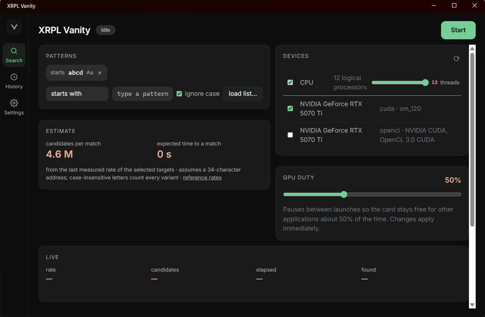

# XRPL Vanity desktop application

A Windows desktop front end for the same search engine the `xrpl-vanity` command line
tool uses. It is a .NET MAUI host (`src/XrplVanity.App`) that renders a Blazor Hybrid UI
(`src/XrplVanity.App.Core`) inside WebView2, and it drives `XrplVanity.Search` directly —
there is no server, no network call, and no process boundary between the UI and the
search.



## Overview

The application has three pages:

- **Search** — build a pattern set (`starts` / `ends` / `contains` / `starts and ends
  with`, case-sensitive or case-insensitive), pick the targets to search on (the CPU
  with a thread count, plus every CUDA and OpenCL device found), see the estimated
  candidates per match and the expected time, set the GPU duty cycle, and watch the
  live rate, candidate count and hits. Every hit lands in the results list with its
  address, pattern, target and time. The four base58 look-alikes absent from the XRPL
  alphabet (`0`, `O`, `I`, `l`) are folded onto the letter they are normally mistaken
  for (`0`/`O` → `o`, `I` → `i`, `l` → `L`) rather than rejected, and the chip shows the
  folded form next to what you typed.
  Choosing `starts and ends with` swaps the single text box for two — `starts with…`
  and `ends with…` — and requires both before the rule is added; the resulting chip
  labels both halves (`starts abc`, `ends xyz`) and costs exactly as much as a single
  `starts` pattern of the combined length, since the estimate multiplies the two
  independent halves. The halves may touch but never overlap, so halves totalling more
  than 33 characters — the longest address body — are flagged as unreachable rather than
  searched for.
  A pattern set can be written to a file with `save list…` and read back with `load
  list…`. The file is UTF-8 text, one rule per line, fields separated by tabs:
  `ends<TAB>RRRRRRRR`, a case-sensitive rule adding the same `Aa` marker its chip wears,
  and a paired rule spelling out both halves as `starts<TAB>static<TAB>ends<TAB>bit`. A
  line holding a single word and no tab at all is a plain word list entry — the format
  the command line tool's `--list` reads — and becomes a `starts` rule carrying whatever
  the `ignore case` box says at the time, so existing word lists keep loading unchanged.
  Loading adds to the chips already on screen rather than replacing them, and never twice: a
  line naming a rule the set already holds is skipped, as is a rule typed into the entry box
  by hand. Two chips are the same rule when their position, their case flag and their
  — normalized — text agree, so `starts 00000000` and `starts oooooooo` are one rule, and
  `static` and `STATIC` are one rule only while the case is ignored. Blank lines are skipped,
  and a line outside the grammar is skipped too; below the entry row a grey note says what
  the load passed over (`34 duplicates skipped. 2 lines could not be read and were skipped.`).
  The card header counts the chips and carries **Clear**, which empties the set behind the
  same confirmation dialog History uses. Past twelve chips the set is cut down to the first
  ten with a `+N more` button after them; expanded, it shows everything and scrolls inside the
  card rather than pushing the estimate and the results off the page. The expanded state is
  not remembered between runs.
  A found wallet can also leave as a QR code rather than as a file. The button in a result row
  shows that one wallet; `Show QR…` in the selection bar shows every selected row. The dialog
  offers two payloads: the StaticBit backup container, which the StaticBit wallet restores from
  by scanning, and the bare `sEd…` seed, which it does not import and which is offered only for
  a single wallet. A password is optional and encrypts the container; without one the code is
  not encrypted and says so. One code holds 22 wallets, or 21 with a password. Nothing is
  written to disk — the code is inline SVG, never an image file, and it hides itself after 60
  seconds. Under it are links to the wallet on the App Store and Google Play. The format and
  the container are documented in `docs/2026-09-13-xrpl-vanity-qr-export-design.md`.
- **History** — every result the application has ever stored, narrowed by two filters
  that work together: a text box over the address and the pattern, and a drop-down over
  the pattern column alone. The drop-down lists every stored pattern once per position it
  was matched at, with its row count — `fast (starts) — 12`, `fast (ends) — 3`,
  `abc:xyz (pair) — 1` — so one word searched as a prefix and as a suffix stay two
  separate choices, and `All patterns` returns the whole history. Deleting the last row
  of the chosen pattern drops that choice back to `All patterns` rather than leaving an
  empty list. Each row carries a checkbox, and a "select all shown" checkbox
  above the list adds every row the filters currently show; unticking it removes only
  those rows from the selection, and it draws as a dash rather than a tick when the
  visible rows are only partly selected. Picking a pattern and ticking "select all shown"
  is therefore how a whole pattern gets exported or deleted in one go. The selection is
  held by address, so narrowing either filter hides rows without unselecting them, and
  selected rows are tinted so the selection is legible without reading the checkboxes. Once anything is selected, the
  count ("3 selected") and the buttons `Export selected…`, `Delete selected` and
  `Clear selection` appear on the right of that same "select all shown" row, which is
  held open whether or not anything is selected so that ticking the first checkbox never
  shifts the list. The header's `Export TSV…` is disabled while a selection exists, and
  `Clear selection` is what empties the selection outright. One
  confirmation dialog covers the row delete, `Delete selected` and `Clear history`: it
  names the seed, not the row, as the thing that cannot be recovered. The row and
  selection variants list the addresses being deleted, up to ten, collapsing the rest into
  "…and N more" (never a seed); the clear variant states the total instead and notes that
  the filters do not narrow it. The confirm button is always red, reading `Delete`,
  `Delete N` or `Clear history` depending on the path; `Cancel` takes focus so a stray
  Enter is harmless, and Escape cancels the same way. A read-only store hides both delete
  paths — the row's delete button and `Delete selected` — while the checkboxes and
  `Export selected…` still work.
- **Settings** — everything in the table below. There is no Save button: each control
  writes to `settings.json` as it changes.

### Settings

| Setting | Meaning | Default |
| --- | --- | --- |
| Close button | What the × in the title bar does: ask every time, minimise to tray, or exit. | Ask every time |
| Notifications | A toast on a match and when a search finishes. Disabled, with a note, when the platform refuses registration (an unpackaged build has no package identity). | On |
| GPU duty (applies immediately) | Share of the time the GPU runs, 25–100 %. The same value as the Search page's slider and the tray menu; a change reaches a running search at once. | 100 |
| Stop after N matches | The session ends by itself once it has found this many. Blank or 0 searches until you press Stop. | blank |
| Clear clipboard after copying a seed | Seconds before a copied seed is wiped, and only if the clipboard still holds it. Copying anything else in the meantime keeps the newer content. | 30 |
| Hide a revealed seed after | Seconds before a revealed seed masks itself again. It is also masked when you leave the page. | 15 |
| Rate hints | The last measured speed per device, used for the estimate before a run. **Forget rate hints** clears them. | — |
| Data folder | Where `settings.json` and `results.dat` live, with **Open folder**. | — |
| About | Version, search engines, font licences, and links to the project on GitHub, StaticBit on GitHub, X and staticbit.io. | — |

Seeds are masked everywhere by default. A row reveals its seed only on request and hides
it again after the configured timeout or when the page is left. Copying a seed puts it on
the clipboard and clears it after the configured delay, but only if the clipboard still
holds that same seed.

### Where the data is

Both files live in the packaged application's local data folder,
`%LOCALAPPDATA%\Packages\io.staticbit.vanity_<publisher hash>\LocalState` (the Settings
page prints the resolved path, and **Open folder** opens it):

| File | Contents |
| --- | --- |
| `settings.json` | Pattern and target drafts, thread count, duty, match count limit, window size, close behaviour, notification flag, clipboard and reveal timeouts, and the last measured rate per device. Plain JSON, no secrets. |
| `results.dat` | The stored results, including seeds. Encrypted with DPAPI (`ProtectedData.Protect`, `DataProtectionScope.CurrentUser`), so only the Windows account that wrote the file can read it. |

`results.dat` is the only file the application writes that contains a seed. Nothing else
on disk, in a log, in a notification or in the tray menu ever carries one. A TSV export
written from the results list does contain seeds — it is a file you asked for, in a
location you chose, and it is not protected.

## Requirements

- Windows 10 version 1809 (build 17763) or newer, x64.
- The **Microsoft Edge WebView2 runtime**. It ships with Windows 11 and with current
  Windows 10 updates; if it is missing the window opens blank (see
  [Troubleshooting](#troubleshooting)).
- For GPU search, either an NVIDIA driver (CUDA) or any installed OpenCL platform. With
  neither, the application says so and searches on the CPU.
- The MSIX package is self-contained: no .NET runtime has to be installed separately.

## Build and run from source

The .NET 10 SDK and the MAUI Windows workload are required:

```powershell
dotnet workload install maui-windows
```

Debug builds run unpackaged (`WindowsPackageType=None`), so they start straight out of
`bin/` and need no signing certificate:

```powershell
dotnet build src/XrplVanity.App/XrplVanity.App.csproj -c Debug -f net10.0-windows10.0.22621.0 -t:Run
```

An unpackaged build has no package identity, so Windows notifications are unavailable and
the Settings page marks the toggle accordingly. Everything else behaves the same.

The unit tests for the UI layer run like every other suite in this repository — as an
executable, never through `dotnet test`:

```powershell
dotnet run --project tests/XrplVanity.App.Tests -c Release
```

Only the application project is Windows-only. The rest of the solution builds anywhere
through the solution filter `XrplVanity.Portable.slnf`, which is what the Linux test
harness uses.

## Package as MSIX

Release builds are MSIX. A sideloaded package has to be signed, so the first step is a
self-signed code-signing certificate whose subject matches the `Publisher` in
`src/XrplVanity.App/Platforms/Windows/Package.appxmanifest`
(`CN=StaticBit Vanity Dev`).

### 1. Create the certificate

Run once per machine that builds packages:

```powershell
powershell -ExecutionPolicy Bypass -File app/make-cert.ps1
```

The script creates the certificate in `Cert:\CurrentUser\My`, exports `app/XrplVanityDev.pfx`
and `app/XrplVanityDev.cer` next to itself, and prints the thumbprint. Both exported files
are gitignored; the certificate is a development artefact and must never be committed.

### 2. Publish

Pass the thumbprint the script printed:

```powershell
dotnet publish src/XrplVanity.App/XrplVanity.App.csproj -c Release -f net10.0-windows10.0.22621.0 -p:PublishProfile=MSIX-win-x64 -p:PackageCertificateThumbprint=<thumbprint>
```

The package lands in `src/XrplVanity.App/bin/msix/XrplVanity.App_1.0.0.0_x64_Test/` as
`XrplVanity.App_1.0.0.0_x64.msix`, about 73.3 MB because the build is self-contained.

The publish profile signs from the certificate store rather than from the `.pfx`. The
Windows App SDK packaging targets cannot import a password-protected key file — they
fail with `APPX0105: Cannot import the key file` and `APPX0107: The certificate specified
is not valid for signing` even when `PackageCertificatePassword` is supplied — while the
same certificate resolves cleanly by thumbprint. That is why
`MSIX-win-x64.pubxml` carries an empty `PackageCertificateKeyFile`, a deliberate deviation
from a straight `.pfx` reference: the `.pfx` still exists and is still exported by
`make-cert.ps1`, but only so the certificate can be moved to another build machine — it is
never read by the publish itself, which always signs by thumbprint from the local store.

### 3. Trust the certificate and install

The signing certificate is its own root, so Windows refuses the package
(`0x800B0109: the root certificate of the signature in the app package must be trusted`)
until the certificate is trusted machine-wide. Both commands need an **elevated**
prompt, and the first one changes a machine-wide trust store:

```powershell
certutil -addstore -f TrustedPeople app\XrplVanityDev.cer
Add-AppxPackage -Path src\XrplVanity.App\bin\msix\XrplVanity.App_1.0.0.0_x64_Test\XrplVanity.App_1.0.0.0_x64.msix
```

"XRPL Vanity" then appears in the Start menu. Double-clicking the `.msix` in Explorer
does the same thing through the App Installer once the certificate is trusted.

To uninstall:

```powershell
Get-AppxPackage -Name io.staticbit.vanity | Remove-AppxPackage
```

### Installing without elevation, during development

With **Developer Mode** enabled, Windows can register the published layout in place,
which gives the application a real package identity — its own `LocalState` folder, a
Start menu entry and working notifications — without a trusted certificate and without
elevation:

```powershell
Copy-Item src\XrplVanity.App\bin\Release\net10.0-windows10.0.22621.0\win-x64\AppxManifest.xml src\XrplVanity.App\bin\publish\
Add-AppxPackage -Register src\XrplVanity.App\bin\publish\AppxManifest.xml
```

Register `bin\publish\`, not the build output under `bin\Release\...\win-x64\`: only the
publish layout contains `wwwroot`, and a package registered without it opens on WebView2's
"can't reach this page" error. After changing `Package.appxmanifest`, remove the previous
registration first (`Remove-AppxPackage -Package io.staticbit.vanity_1.0.0.0_x64__<hash> -PreserveApplicationData`)
— Windows refuses to re-register the same version otherwise.

## Fonts and third-party assets

| Asset | Version | Licence |
| --- | --- | --- |
| [Inter](https://github.com/rsms/inter/releases/tag/v4.1) (`Inter-Regular`, `Inter-Medium`, `Inter-SemiBold`) | v4.1 | SIL Open Font License 1.1 — `src/XrplVanity.App.Core/wwwroot/fonts/LICENSE-Inter.txt` |
| [Cascadia Code](https://github.com/microsoft/cascadia-code/releases/tag/v2407.24) | v2407.24 | SIL Open Font License 1.1 — `src/XrplVanity.App.Core/wwwroot/fonts/LICENSE-CascadiaCode.txt` |
| [Bootstrap](https://getbootstrap.com/) (`bootstrap.min.css` only) | 5.3.3 | MIT — `src/XrplVanity.App.Core/wwwroot/lib/bootstrap/LICENSE` |
| [H.NotifyIcon.Maui](https://github.com/HavenDV/H.NotifyIcon) (tray icon and menu) | 2.4.1 | MIT |
| [QRCoder](https://github.com/codebude/QRCoder) | 1.8.0 | MIT — the module matrix only; this application draws the code as inline SVG itself |

The fonts and the Bootstrap stylesheet are vendored into the repository so the
application never fetches anything at run time.

## Manual smoke checklist

Run this against an installed package after any change to the host, the packaging or the
storage layer. Each step names what you should see.

1. **Install the certificate and the package.** `certutil -addstore -f TrustedPeople` and
   `Add-AppxPackage` both succeed from an elevated prompt, and "XRPL Vanity" appears in
   the Start menu.
2. **Launch.** The window opens at 1100 × 720 with the Search page, the nav rail, and the
   device list populated; the status pill reads *Idle* and Start is disabled with the hint
   "Add at least one reachable pattern."
3. **No-GPU banner.** On a machine with neither an NVIDIA driver nor an OpenCL platform,
   the device list shows only the CPU row and a yellow banner reads "No CUDA driver or
   OpenCL platform found — searching on the CPU". Start stays enabled.
4. **Measure speed.** With a device selected and no search running, press **measure
   speed** on the Devices card: it reads "measuring…" and disables itself, then returns
   to "measure speed" and the ESTIMATE card starts showing a time instead of "rate
   unknown".
5. **Start and stop on the CPU.** Add a short pattern, leave only CPU selected, press
   Start: the pill turns *Searching*, the rate, candidate and found counters climb, and
   the CPU row reads *running*. Press Stop: the pill returns to *Idle*, the row reads
   *finished*, and the final rate stays on screen.
6. **Start and stop on the GPU.** Clear the CPU checkbox, select a `cuda` or `opencl`
   device and repeat. The device row shows the device name and its own rate, which should
   be two orders of magnitude above the CPU rate.
7. **Paired pattern.** Switch the position selector to `starts and ends with`: the single
   text box is replaced by two, `starts with…` and `ends with…`. Fill both and press
   Enter (or Start with both non-empty): the chip reads `starts <prefix>` `ends <suffix>`,
   with the `Aa` marker when case-sensitive and the same per-half warnings a single
   pattern shows. Run a short paired search on the GPU: a hit only appears once both
   halves are present in the same address, and the results list shows the `prefix..suffix`
   form for it.
8. **Duty from the tray during a search.** With a GPU search running, open the tray menu
   and pick a different duty percentage. The GPU duty card on the Search page follows
   immediately and the measured rate scales with it.
9. **Toast on a hit.** With notifications enabled, each match raises a Windows toast
   titled "Match found" showing the address, the pattern and the position — never a seed.
10. **Toast on completion.** Stopping or completing a search raises a "Search finished"
    toast with the number of hits and the outcome.
11. **Close to tray and remembering the choice.** With **Close button** set to "Ask every
    time", the × opens the prompt; choosing "Minimize to tray" with *Remember my choice*
    ticked hides the window, keeps the process alive and writes `"CloseBehavior": "MinimizeToTray"`
    to `settings.json`. The next × hides the window without asking.
12. **History survives a restart.** Exit from the tray menu, launch again, open History:
    every stored result is still there, seeds still masked.
13. **Clipboard clears.** Copy a seed from a result row, paste it somewhere to confirm it
    arrived, wait out the "Clear clipboard after copying a seed" delay (30 s by default)
    and paste again: the clipboard is empty. Copying anything else in the meantime keeps
    the newer content.
14. **Export.** Press **Export TSV…**, save the file and open it in a text editor: one
    line per result, address and seed separated by a tab, in the same format the command
    line tool's `--out` writes.
15. **Select, export and delete together.** On History, tick two rows (or tick "select
    all shown" and then untick the rest), press **Export selected…** and save the file:
    the file holds exactly those two lines. Press **Delete selected**: the confirmation
    dialog names both addresses; confirming removes both rows and nothing else.
16. **The pattern filter narrows and composes.** Run two searches that store results for
    different patterns, then on History open the pattern drop-down: each pattern appears
    once per position with its row count. Pick one — only its rows remain, and typing in
    the text box narrows that further rather than widening it. Tick "select all shown",
    switch back to `All patterns` and confirm the count in the selection bar is unchanged:
    hiding rows never unselects them. Delete every row of the chosen pattern and the
    drop-down returns to `All patterns` on its own.
17. **Every control is dark.** Open History and Settings and check each form control: the
    filter box, the pattern drop-down, the close-behaviour select, the four number inputs,
    the notifications checkbox and both scrollbars. Nothing may render on a white background, and no
    checkbox may show a white or blue box.
18. **A read-only data folder produces banners, not crashes.** Deny your account write
    access to the data folder (`icacls "<folder>" /deny "%USERNAME%":(W)`), then: on
    History, delete a row through its dialog — the confirmed action shows a red banner
    with the reason and leaves the list intact. That first failure turns the store
    read-only for the rest of the process, which removes every destructive control at
    once: **Clear history** disappears from the header, the row delete buttons go, and so
    does **Delete selected**, while the checkboxes and **Export selected…** keep working.
    Only one of the two delete paths can be checked per session for that reason — to see
    the **Clear history** banner instead, restart the application with the folder still
    denied and press it first. On Search, run a short pattern and confirm the same banner
    appears above the results list while the hits still accumulate on screen; and confirm
    the window still closes normally. Restore access with
    `icacls "<folder>" /remove:d "%USERNAME%"`.
19. **The reference-rates link opens in a browser.** On the Search page, click
    **reference rates** in the estimate note: the benchmarks page opens in the default
    browser and the application window is unchanged — no blank frame inside the app.
20. **Save a pattern list and load it back.** Build a set that mixes the positions — one
    `starts`, one `ends`, one `contains` and one `starts and ends with`, at least one of
    them case-sensitive — then press **save list…** and save the file. Open it in a text
    editor: one tab-separated line per chip, the paired rule spelling out both halves.
    Remove every chip (**save list…** goes disabled once the last one is gone), press
    **load list…** and choose the same file: every chip returns with its position and its
    `Aa` marker, whichever way the `ignore case` box is set.
21. **Loading a list twice changes nothing the second time.** With the file from step 20 still
    on disk and its chips on screen, press **load list…** and choose it again: no chip is
    added, and the grey note below the entry row reads `4 duplicates skipped.` Type one of the
    same patterns into the entry box and press Enter: the note reads `That pattern is already
    in the list.` and no chip appears.
22. **A long set folds itself away.** Load a word list of forty or more words: the card shows
    ten chips and a `+30 more` button, and the ESTIMATE card below is still on screen without
    scrolling. Press the button: every chip appears, the area scrolls inside the card, and the
    button reads `show less`.
23. **Clear asks first.** Press **Clear** in the Patterns header: the dialog reads
    `Clear 40 patterns?`, the page behind it does not answer clicks, and Escape or `Cancel`
    leaves every chip in place. Press it again and confirm: the card empties, Start goes back
    to disabled with "Add at least one reachable pattern.", and both **Clear** and
    **save list…** go disabled.
24. **A wallet crosses to the phone as a QR code.** With at least one result on screen, press the
    QR button in its row. The dialog opens, the page behind it does not answer clicks, and no
    code is drawn yet. Press **Show code**: a QR code appears on a white plate with the warning
    that it is not encrypted, the caption "Scan with StaticBit on your phone." and the two store
    links. Right-click the code — the menu offers no "Save image as…". Wait 60 s: the code
    disappears and **Show code** comes back.
25. **The code really imports.** Decode a produced code with `tools/backup-decoder/index.html`
    from the wallet repository and confirm it lists the addresses. Then scan the on-screen code
    with StaticBit's restore screen on a phone: the wallets it offers are exactly the rows that
    were selected, each labelled with the pattern that matched. Repeat once with a password.
    This is the only check that the container still matches what the wallet expects — nothing in
    this repository notices when that format changes.
26. **A selection that does not fit is refused.** Select forty rows on History and press
    **Show QR…**, then **Show code**: nothing is drawn and the dialog says how many of them
    would fit. Reduce the selection to that number and the code appears.

Exiting stops the search first and gives the teardown 10 s before the process ends; the
session's own dispose cap is 30 s, so a session that refuses to settle costs 10 s, not 30.

### One click: run-desktop-app.bat

`run-desktop-app.bat` in the repository root does everything below in one step:
it finds or creates the signing certificate, closes a running instance, publishes,
copies the manifest into the publish layout, registers the package for the current
user and starts the application. Double-click it, or run it from any directory — it
changes to its own folder first. It needs the .NET 10 SDK and Developer Mode, and it
stops with a plain-language message when either is missing. No administrator rights
are required. The rest of this section is what the script does, step by step.

### Run the packaged build without installing it

Installing the `.msix` needs an elevated prompt. To try the packaged application without
one, register the published layout in developer mode (*Settings → System → For
developers → Developer Mode* must be on). Publish first, so `bin\publish\` is current,
then copy the manifest the build produced next to it and register that folder:

```powershell
Copy-Item src\XrplVanity.App\bin\Release\net10.0-windows10.0.22621.0\win-x64\AppxManifest.xml src\XrplVanity.App\bin\publish\
Add-AppxPackage -Register src\XrplVanity.App\bin\publish\AppxManifest.xml
```

"XRPL Vanity" then appears in the Start menu and runs with package identity, so
notifications and the tray behave as they do after a real install. Remove it again with
`Remove-AppxPackage (Get-AppxPackage io.staticbit.vanity).PackageFullName` — that also
deletes the package's `LocalState`, including `results.dat`, so export anything you want
to keep first.

**Do not run `XrplVanity.App.exe` directly from `bin\Release\...\win-x64\` or from
`bin\publish\`.** A Release build is a packaged application: it needs package identity,
and the exe exits immediately with `REGDB_E_CLASSNOTREG` from the Windows App SDK
initialiser without it. `bin\Release\...\win-x64\` is also only an intermediate output
and carries no `wwwroot`, so even registered it would show "can't reach this page". The
publish layout in `bin\publish\` is the complete one. For a loose, runnable build use the
Debug configuration, which is unpackaged:

```powershell
dotnet build src\XrplVanity.App\XrplVanity.App.csproj -c Debug -f net10.0-windows10.0.22621.0 -t:Run
```

A stale registration blocks that too: if a package with the identity `io.staticbit.vanity`
is registered from a folder that no longer holds `AppxManifest.xml`, both the Debug launch
and `Add-AppxPackage -Register` fail. Remove the stale registration first with the
`Remove-AppxPackage` line above.

## Troubleshooting

**The window opens blank or shows "can't reach this page".** The WebView2 runtime is
missing, or the package was registered from a layout without `wwwroot`. Install the
[Evergreen WebView2 runtime](https://developer.microsoft.com/microsoft-edge/webview2/),
and if you registered a loose layout, register `bin\publish\` rather than the build output.

**No devices are listed beyond the CPU.** The application enumerates CUDA through the
NVIDIA driver and OpenCL through the installed ICDs. Install or update the GPU driver,
then press the refresh button on the DEVICES card — it re-runs the enumeration without a
restart.

**Notifications never appear.** The Settings page says whether the platform accepted the
registration at all: "unavailable on this system" means the process has no package
identity (an unpackaged Debug build) or the registration failed. If the toggle is
available and toasts still do not show, check that Windows notifications are on for
"XRPL Vanity" in *Settings → System → Notifications*, and that focus assist / do not
disturb is off. A long run with a short pattern can also queue hundreds of toasts, and
Windows shows them one at a time.

**History is read-only.** DPAPI could not read or write `results.dat` — the banner on the
History page carries the reason. This normally means the file was written by a different
Windows account or was copied from another machine; DPAPI keys are per user. Move the
file aside to start a fresh history.

**A device row turns red mid-search.** That target failed (a driver reset, for example);
the message is on the row. Other targets keep running, and the search only ends if every
target fails.
